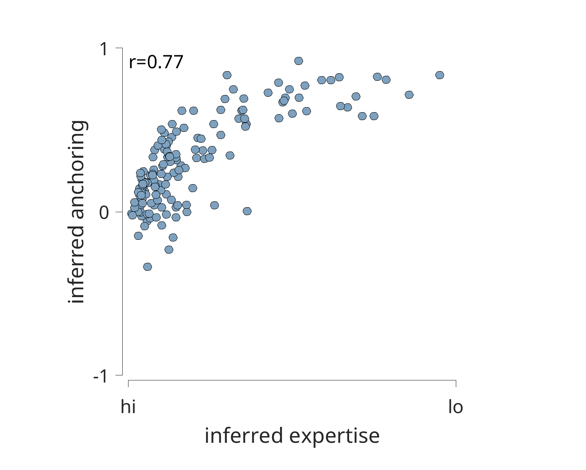
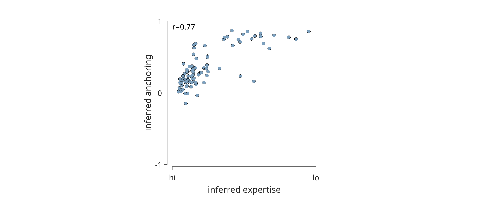
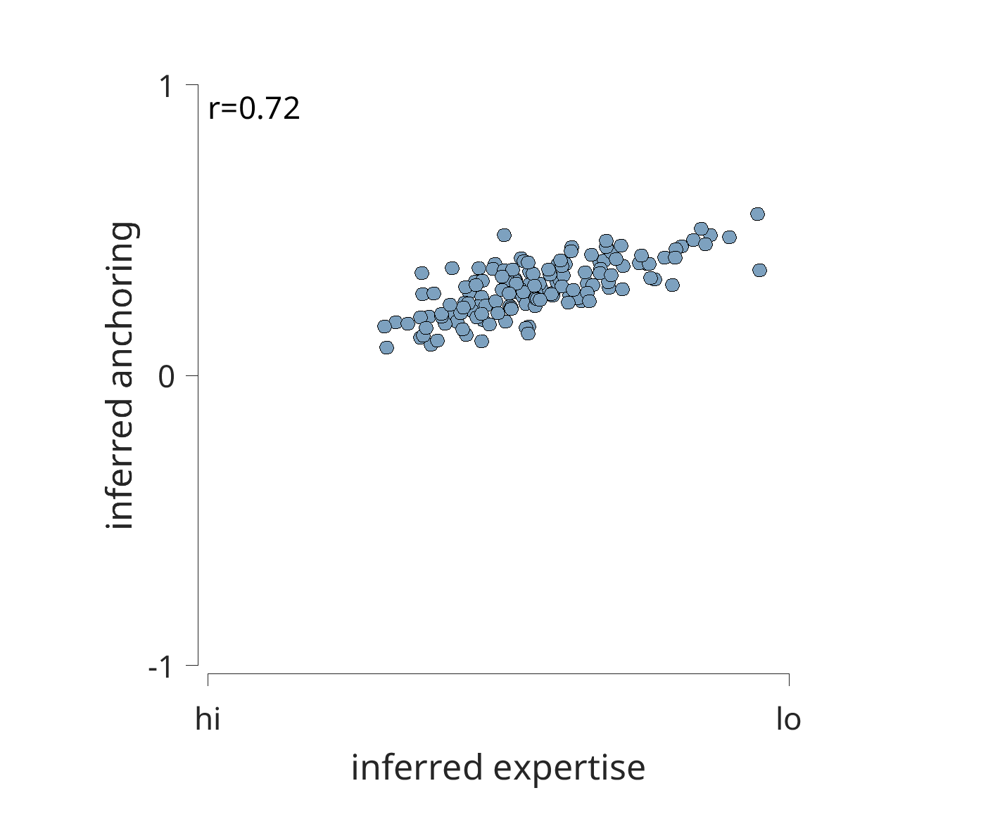
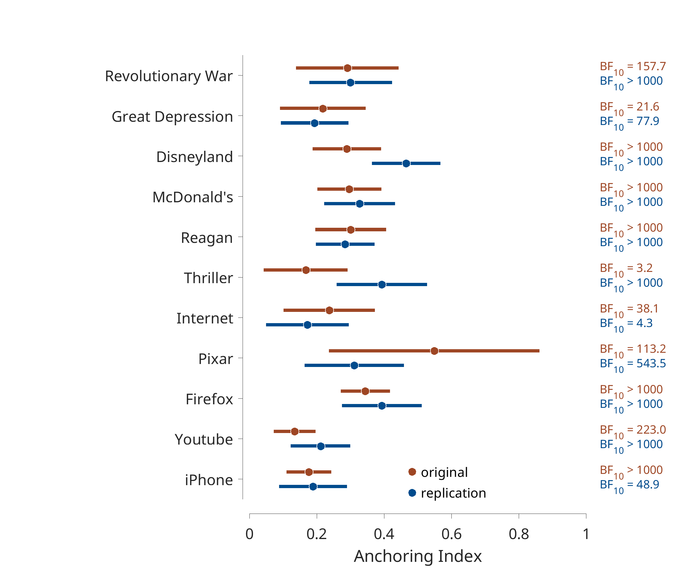
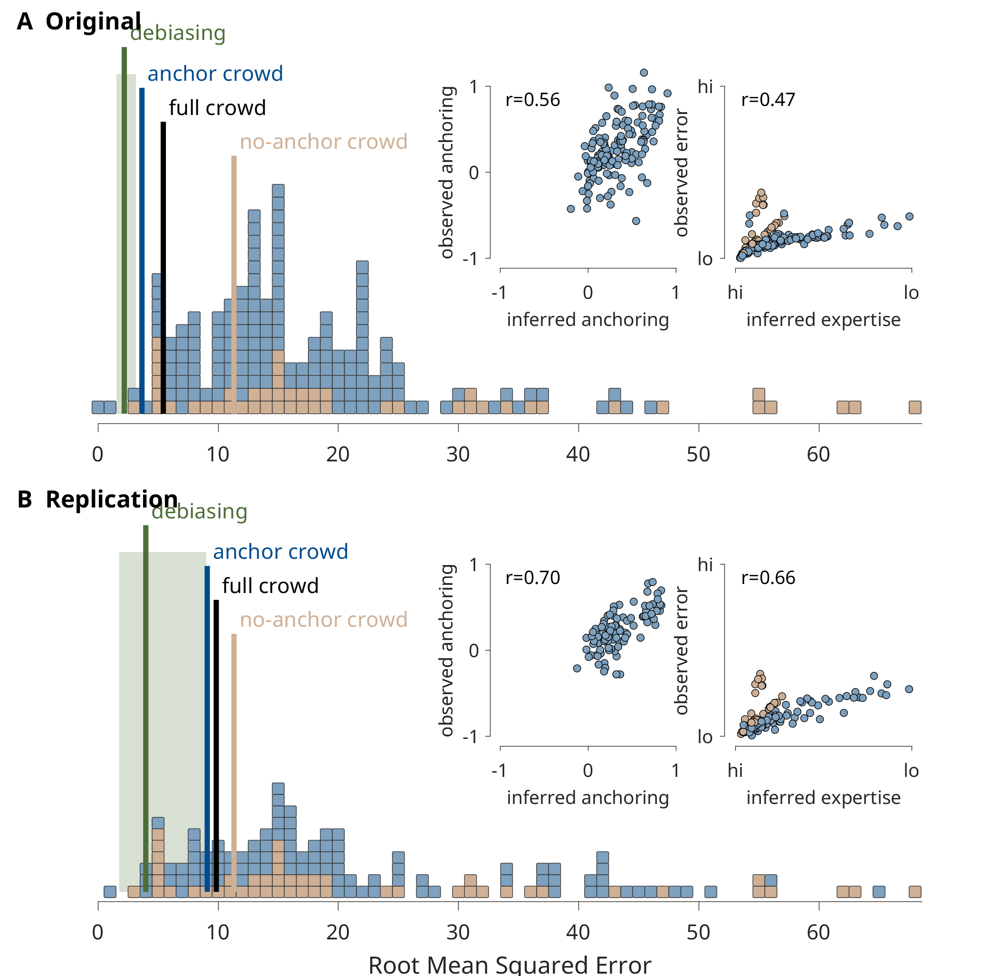

# anchoringInTheYears

Code and data for:

> Lee, M.D., & Dang, A. (2026). Comparing diversity and debiasing approaches to the wisdom of the crowd.

This repository supports the event-years anchoring experiment (original and percentile-anchor replication) and a reanalysis of Experiment 2 from Barrera-Lemarchand et al. (2024). It contains long-format behavioral data, JAGS/MATLAB model scripts, result-generation code, and additional diagnostic outputs.

Online materials that accompany the manuscript—extra figures, tables, and numerical reports—are collected under [Supplementary Analyses](#supplementary-analyses) below, with links into [`analyses/results/`](analyses/results/).

## Repository layout

```
anchoringInTheYears/
├── data/                     # Behavioral data and supporting mats
├── models/
│   ├── anchoringIndex/       # Per-question anchoring-index JAGS model
│   └── debiasing/            # Hierarchical debiasing JAGS model
├── analyses/
│   ├── analyses.m            # Main results driver
│   ├── lib/                  # Plotting / helper functions
│   └── results/
│       ├── diversityPredictionTheorem/   # Per-question two-panel DPT figures
│       ├── anchoringIndex/               # prior/posterior + forest plots
│       ├── performance/
│       ├── debiasingModel/
│       ├── expertiseVsAnchoring/
│       ├── outlierRuleComparison/
│       │   └── contaminantVsOutlier.txt
│       ├── debiasingVsAnchoredPerQuestion/  # per-question debiasing model vs anchor crowd
│       ├── constrainedDebiasing/            # expertise-only / anchoring-only / anchored-only
│       ├── modelRmseCIs/                    # model RMSE point + 95% CIs
│       └── originalAnchorPercentiles/       # subjective anchors as no-anchor percentiles
└── README.md
```

Each figure-producing analysis writes into `analyses/results/<analysisName>/{png,eps}/`. Non-figure artifacts (e.g. `contaminantVsOutlier.txt`) sit beside those folders under the same analysis name.

## Data

### Event years (`data/anchorYearsDecontaminatedLong.csv`)

Long-format estimates after contaminant removal (mean ± 3 SD parse; see `outlierRuleComparison`). Columns:

| Column | Description |
| --- | --- |
| `participant` | Participant ID (1–194) |
| `question` | Question ID (1–11) |
| `version` | Task version (1/2 = anchored; 3 = no anchor) |
| `truth` | Correct year |
| `anchor` | Comparison value (`nan` if no anchor) |
| `highOrLow` | Comparison response (1 = high, 2 = low, `nan` if no anchor) |
| `estimate` | Year estimate |

Question IDs: 1 Thriller, 2 Internet, 3 Disneyland, 4 Great Depression, 5 iPhone, 6 Firefox, 7 Youtube, 8 McDonald's, 9 Revolutionary War, 10 Reagan, 11 Pixar.

Supporting mats used by analysis code:

- `data/anchorYearsData.mat` — structured cleaned event-years data
- `data/pantoneColors.mat` — shared figure colors

### Barrera-Lemarchand Experiment 2 (`data/barreraEtAlExperiment2Long.csv`)

Open data for Experiment 2 of:

> Barrera-Lemarchand, F., Balenzuela, P., Bahrami, B., Deroy, O., & Navajas, J. (2024). Promoting erroneous divergent opinions increases the wisdom of crowds. *Psychological Science, 35*(8), 872–886. https://doi.org/10.1177/09567976241252138

Sourced from [Experiment2withoutlog.mat](https://osf.io/w3ts9) in the [OSF repository](https://osf.io/ch5qw/). Same long-format column names; here `version` encodes group (1 = low anchor, 2 = high anchor, 3 = no anchor). Supporting mat: `data/barreraEtAlExp2.mat`.

## Models

Both model scripts use [Trinity](https://github.com/joachimvandekerckhove/trinity) (`callbayes`) to connect MATLAB and JAGS. Run them from their own folders so relative `storage/` paths resolve correctly.

### Anchoring index — `models/anchoringIndex/`

- Script: `anchoringIndex.m`
- JAGS: `anchoringIndex_jags.txt`
- Set `questionList` to the question indices to analyze
- Monitors posterior `A` and prior predictive `Aprior`
- Writes `storage/anchoringIndex_<q>_jags.mat`

Priors are scaled from the observed min/max/mean of the estimates for each question.

### Debiasing model — `models/debiasing/`

- Script: `debiasing.m`
- JAGS: `debiasing_jags.txt`
- Long-format nodes: `y`, `participant`, `question`, `anchor`, `version`
- Monitors crowd means `mu` and person-level `alpha` (anchor weight) and `sigma` (expertise)
- Writes `storage/debiasing_<dataName>_jags.mat`

Toggle `dataName` / CSV inside `debiasing.m` to fit event years or Barrera Exp 2.

---

## Supplementary Analyses

The main manuscript summarizes the primary analyses. Additional figures, tables, and numerical reports live under [`analyses/results/`](analyses/results/). This section collects that material: short context for each analysis, key results inlined where practical, and links to the source files.

Filename tags used below: `anchorYears` / `AllQuestions` = original experiment; tags containing `F2026` = replication experiment; `barreraLemarchandExperiment2` = Barrera Exp 2.

| Topic | Jump | Repository path |
| --- | --- | --- |
| Constrained-model comparisons | [below](#constrained-model-comparisons) | [`analyses/results/constrainedDebiasing/`](analyses/results/constrainedDebiasing/) |
| Expertise vs anchoring | [below](#expertise-vs-anchoring) | [`analyses/results/expertiseVsAnchoring/`](analyses/results/expertiseVsAnchoring/) |
| Contaminant vs outlier rules | [below](#contaminant-vs-outlier-rules) | [`analyses/results/outlierRuleComparison/contaminantVsOutlier.txt`](analyses/results/outlierRuleComparison/contaminantVsOutlier.txt) |
| Debiasing vs anchored crowd (per question) | [below](#debiasing-vs-anchored-crowd-per-question) | [`analyses/results/debiasingVsAnchoredPerQuestion/`](analyses/results/debiasingVsAnchoredPerQuestion/) |
| Diversity Prediction Theorem panels | [below](#diversity-prediction-theorem-panels) | [`analyses/results/diversityPredictionTheorem/`](analyses/results/diversityPredictionTheorem/) |
| Anchoring indices | [below](#anchoring-indices) | [`analyses/results/anchoringIndex/`](analyses/results/anchoringIndex/) |
| Performance summaries | [below](#performance-summaries) | [`analyses/results/performance/`](analyses/results/performance/) |
| Model RMSE credible intervals | [below](#model-rmse-credible-intervals) | [`analyses/results/modelRmseCIs/`](analyses/results/modelRmseCIs/) |
| Original-anchor percentiles | [below](#original-anchor-percentiles) | [`analyses/results/originalAnchorPercentiles/`](analyses/results/originalAnchorPercentiles/) |

### Constrained-model comparisons

**Folder:** [`analyses/results/constrainedDebiasing/`](analyses/results/constrainedDebiasing/)

The full debiasing model jointly infers person-specific expertise ($\sigma_i$) and anchoring ($\alpha_i$). To separate their contributions, nested and restricted variants are also fit:

| Variant | Restriction |
| --- | --- |
| Debiasing model (full) | Person-specific $\sigma_i$ and $\alpha_i$ |
| Expertise only | $\alpha_i = 0$ (no anchoring adjustment) |
| Anchoring only | Shared expertise (common $\sigma$), person-specific $\alpha_i$ |
| Debiasing model, anchored only | Full model, low/high-anchor individuals only |

Model RMSE point estimates and 95% credible intervals are taken from [`modelRmseCIs/modelRmseCIs.txt`](analyses/results/modelRmseCIs/modelRmseCIs.txt) ([Model RMSE credible intervals](#model-rmse-credible-intervals)). Crowd baselines come from the plain dumps in the constrained-model folder.

**Original experiment**

| Method | Result |
| --- | --- |
| Full crowd | RMSE 5.43 |
| Anchor crowd | RMSE 3.66 |
| No-anchor crowd | RMSE 11.32 |
| Debiasing model (full) | RMSE 2.19 (95% CI = 1.56 to 3.16) |
| Expertise only | RMSE 1.76 (95% CI = 1.25 to 2.55) |
| Anchoring only | RMSE 7.02 (95% CI = 6.13 to 8.29) |
| Debiasing model, anchored only | RMSE 1.83 (95% CI = 1.01 to 3.44) |

Source dump: [`constrainedDebiasing/anchorYears.txt`](analyses/results/constrainedDebiasing/anchorYears.txt)

**Replication experiment**

Crowd baselines in the dual performance panel ([Performance summaries](#performance-summaries)) share the original experiment’s no-anchor condition (full 9.84 / anchor 9.09 / no-anchor 11.32). Model rows:

| Method | Result |
| --- | --- |
| Debiasing model (full) | RMSE 3.98 (95% CI = 1.77 to 9.00) |
| Expertise only | RMSE 1.91 (95% CI = 1.31 to 3.48) |
| Anchoring only | RMSE 15.86 (95% CI = 13.80 to 18.77) |
| Debiasing model, anchored only | RMSE 3.36 (95% CI = 1.51 to 9.40) |

**Barrera Experiment 2**

| Method | Result |
| --- | --- |
| Full crowd | RMSE 17.06 |
| Anchor crowd | RMSE 16.90 |
| No-anchor crowd | RMSE 17.70 |
| Debiasing model (full) | RMSE 16.71 (95% CI = 16.20 to 17.41) |
| Expertise only | RMSE 16.88 (95% CI = 16.41 to 17.47) |
| Anchoring only | RMSE 16.84 (95% CI = 16.34 to 17.50) |
| Debiasing model, anchored only | RMSE 16.49 (95% CI = 15.87 to 17.57) |

Source dump: [`constrainedDebiasing/barreraLemarchandExperiment2.txt`](analyses/results/constrainedDebiasing/barreraLemarchandExperiment2.txt).

In the original and replication experiments, expertise-only is competitive with (or better than) the full model, while anchoring-only is much worse. On Barrera Exp 2 the variants are nearly tied, with anchored-only slightly best. The relative contribution of the two mechanisms appears design-dependent.

### Expertise vs anchoring

**Folder:** [`analyses/results/expertiseVsAnchoring/`](analyses/results/expertiseVsAnchoring/) · **Figures:** [`png/`](analyses/results/expertiseVsAnchoring/png/)

Scatterplots of posterior-mean expertise ($\sigma_i$; smaller = more expert) against posterior-mean anchoring ($\alpha_i$). Correlations reported in the manuscript are $r = 0.77$ for both the original experiment and the replication experiment, and $r = 0.72$ for Barrera Exp 2. Across datasets, inferred anchoring approaches zero as expertise increases.







### Contaminant vs outlier rules

**Folder:** [`analyses/results/outlierRuleComparison/`](analyses/results/outlierRuleComparison/)  
**Report:** [`analyses/results/outlierRuleComparison/contaminantVsOutlier.txt`](analyses/results/outlierRuleComparison/contaminantVsOutlier.txt)

The cleaned data used throughout the paper remove *contaminants* with a mean ± 3 SD parse per question (with a second pass on questions where a single extreme value shifts the mean and SD). An alternative is a standard IQR boxplot rule (values outside $[Q_1 - 1.5\,\mathrm{IQR},\, Q_3 + 1.5\,\mathrm{IQR}]$). The consolidated report compares the two rules for the original experiment and the replication experiment. Analyses retain the parse; the IQR comparison is diagnostic only.

| Study | Finite answers | Parse removals (kept) | IQR flags (kept) | Agreement |
| --- | ---: | ---: | ---: | ---: |
| Original experiment | 2134 | 31 (2103) | 92 (2042) | 97.1% |
| Replication experiment | 920 | 12 (908) | 34 (886) | 97.6% |

Every parse removal is also an IQR flag. The IQR rule alone would additionally drop many non-contaminant estimates (61 original; 22 replication). Exact values are listed in the report and in the manuscript appendix table of contaminants.

### Debiasing vs anchored crowd per question

**Folder:** [`analyses/results/debiasingVsAnchoredPerQuestion/`](analyses/results/debiasingVsAnchoredPerQuestion/)

Aggregate RMSE favors the debiasing model over the anchored-crowd mean. These reports break that comparison down question by question. Absolute error is $|\mathrm{estimate} - \mathrm{truth}|$; the anchor crowd is the mean of low- and high-anchor estimates; the model estimate is the posterior mean of $\mu_q$.

| Dataset | Model better | Anchor-crowd RMSE | Model RMSE |
| --- | --- | ---: | --- |
| Original experiment | **9 / 11** (worse: Disneyland, McDonald’s) | 3.66 | 2.19 (95% CI = 1.56 to 3.16) |
| Replication experiment | **9 / 11** (worse: YouTube, Reagan) | 9.09 | 3.98 (95% CI = 1.77 to 9.00) |
| Barrera Exp 2 | **20 / 30** | 16.90 | 16.71 (95% CI = 16.20 to 17.41) |

**Original experiment** ([`anchorYears.txt`](analyses/results/debiasingVsAnchoredPerQuestion/anchorYears.txt))

| Question | Truth | Anchor crowd | Model | \|err\| A | \|err\| M | Model better? |
| --- | ---: | ---: | ---: | ---: | ---: | --- |
| Thriller | 1983 | 1986.43 | 1985.60 | 3.43 | 2.60 | yes |
| Internet | 1983 | 1982.03 | 1983.60 | 0.97 | 0.60 | yes |
| Disneyland | 1955 | 1959.70 | 1960.25 | 4.70 | 5.25 | no |
| Great Depression | 1929 | 1931.72 | 1928.99 | 2.72 | 0.01 | yes |
| iPhone | 2007 | 2005.10 | 2006.74 | 1.90 | 0.26 | yes |
| Firefox | 2004 | 1998.29 | 2000.78 | 5.71 | 3.22 | yes |
| YouTube | 2005 | 2003.44 | 2004.52 | 1.56 | 0.48 | yes |
| McDonald’s | 1955 | 1956.95 | 1957.47 | 1.95 | 2.47 | no |
| Revolutionary War | 1775 | 1782.28 | 1775.02 | 7.28 | 0.02 | yes |
| Reagan | 1981 | 1981.45 | 1981.23 | 0.45 | 0.23 | yes |
| Pixar | 1995 | 1991.98 | 1994.00 | 3.02 | 1.00 | yes |

**Replication experiment** ([`anchorYearsF2026.txt`](analyses/results/debiasingVsAnchoredPerQuestion/anchorYearsF2026.txt))

| Question | Truth | Anchor crowd | Model | \|err\| A | \|err\| M | Model better? |
| --- | ---: | ---: | ---: | ---: | ---: | --- |
| Thriller | 1983 | 1987.64 | 1986.08 | 4.64 | 3.08 | yes |
| Internet | 1983 | 1985.54 | 1982.03 | 2.54 | 0.97 | yes |
| Disneyland | 1955 | 1968.29 | 1960.91 | 13.29 | 5.91 | yes |
| Great Depression | 1929 | 1933.97 | 1928.53 | 4.97 | 0.47 | yes |
| iPhone | 2007 | 2006.02 | 2006.48 | 0.98 | 0.52 | yes |
| Firefox | 2004 | 1997.34 | 2000.25 | 6.66 | 3.75 | yes |
| YouTube | 2005 | 2004.70 | 2004.35 | 0.30 | 0.65 | no |
| McDonald’s | 1955 | 1959.75 | 1957.58 | 4.75 | 2.58 | yes |
| Revolutionary War | 1775 | 1798.70 | 1776.72 | 23.70 | 1.72 | yes |
| Reagan | 1981 | 1981.82 | 1981.86 | 0.82 | 0.86 | no |
| Pixar | 1995 | 1987.99 | 1993.59 | 7.01 | 1.41 | yes |

Barrera (30 questions): [`barreraLemarchandExperiment2.txt`](analyses/results/debiasingVsAnchoredPerQuestion/barreraLemarchandExperiment2.txt)

### Diversity Prediction Theorem panels

**Folder:** [`analyses/results/diversityPredictionTheorem/`](analyses/results/diversityPredictionTheorem/) · **Figures:** [`png/`](analyses/results/diversityPredictionTheorem/png/)

Two-panel Diversity Prediction Theorem decompositions (individual error, diversity, and crowd error) for each question.

**Original and replication experiments**

| Question | Original experiment | Replication experiment |
| --- | --- | --- |
| Revolutionary War | [figure](analyses/results/diversityPredictionTheorem/png/diversityPredictionTheorem_Revolutionary%20War.png) | [figure](analyses/results/diversityPredictionTheorem/png/diversityPredictionTheorem_anchorYearsF2026_RevolutionaryWar.png) |
| Great Depression | [figure](analyses/results/diversityPredictionTheorem/png/diversityPredictionTheorem_Great%20Depression.png) | [figure](analyses/results/diversityPredictionTheorem/png/diversityPredictionTheorem_anchorYearsF2026_GreatDepression.png) |
| Disneyland | [figure](analyses/results/diversityPredictionTheorem/png/diversityPredictionTheorem_Disneyland.png) | [figure](analyses/results/diversityPredictionTheorem/png/diversityPredictionTheorem_anchorYearsF2026_Disneyland.png) |
| McDonald’s | [figure](analyses/results/diversityPredictionTheorem/png/diversityPredictionTheorem_McDonald%27s.png) | [figure](analyses/results/diversityPredictionTheorem/png/diversityPredictionTheorem_anchorYearsF2026_McDonaldS.png) |
| Reagan | [figure](analyses/results/diversityPredictionTheorem/png/diversityPredictionTheorem_Reagan.png) | [figure](analyses/results/diversityPredictionTheorem/png/diversityPredictionTheorem_anchorYearsF2026_Reagan.png) |
| Thriller | [figure](analyses/results/diversityPredictionTheorem/png/diversityPredictionTheorem_Thriller.png) | [figure](analyses/results/diversityPredictionTheorem/png/diversityPredictionTheorem_anchorYearsF2026_Thriller.png) |
| Internet | [figure](analyses/results/diversityPredictionTheorem/png/diversityPredictionTheorem_Internet.png) | [figure](analyses/results/diversityPredictionTheorem/png/diversityPredictionTheorem_anchorYearsF2026_Internet.png) |
| Pixar | [figure](analyses/results/diversityPredictionTheorem/png/diversityPredictionTheorem_Pixar.png) | [figure](analyses/results/diversityPredictionTheorem/png/diversityPredictionTheorem_anchorYearsF2026_Pixar.png) |
| Firefox | [figure](analyses/results/diversityPredictionTheorem/png/diversityPredictionTheorem_Firefox.png) | [figure](analyses/results/diversityPredictionTheorem/png/diversityPredictionTheorem_anchorYearsF2026_Firefox.png) |
| YouTube | [figure](analyses/results/diversityPredictionTheorem/png/diversityPredictionTheorem_Youtube.png) | [figure](analyses/results/diversityPredictionTheorem/png/diversityPredictionTheorem_anchorYearsF2026_Youtube.png) |
| iPhone | [figure](analyses/results/diversityPredictionTheorem/png/diversityPredictionTheorem_iPhone.png) | [figure](analyses/results/diversityPredictionTheorem/png/diversityPredictionTheorem_anchorYearsF2026_IPhone.png) |

Replication case labels ([`anchorYearsF2026_cases.txt`](analyses/results/diversityPredictionTheorem/anchorYearsF2026_cases.txt); anchor crowd = replication low/high; no-anchor crowd = original experiment no-anchor condition):

| Case | Questions |
| --- | --- |
| Diversity gain outweighs rise in individual error | Thriller, Disneyland, Great Depression, iPhone, McDonald’s |
| Rise in individual error outweighs diversity gain | Internet, Firefox, Revolutionary War, Reagan, Pixar |
| Drop in individual error outweighs loss of diversity | YouTube |

**Barrera Exp 2**

| Question | Figure |
| --- | --- |
| Abortion immoral | [figure](analyses/results/diversityPredictionTheorem/png/diversityPredictionTheorem_barreraLemarchandExperiment2_AbortionImmoral.png) |
| Age 14 or less | [figure](analyses/results/diversityPredictionTheorem/png/diversityPredictionTheorem_barreraLemarchandExperiment2_Age14OrLess.png) |
| Born abroad 80+ | [figure](analyses/results/diversityPredictionTheorem/png/diversityPredictionTheorem_barreraLemarchandExperiment2_BornAbroad80Plus.png) |
| Facebook | [figure](analyses/results/diversityPredictionTheorem/png/diversityPredictionTheorem_barreraLemarchandExperiment2_Facebook.png) |
| Fake news | [figure](analyses/results/diversityPredictionTheorem/png/diversityPredictionTheorem_barreraLemarchandExperiment2_FakeNews.png) |
| Good health | [figure](analyses/results/diversityPredictionTheorem/png/diversityPredictionTheorem_barreraLemarchandExperiment2_GoodHealth.png) |
| Has or seeks job | [figure](analyses/results/diversityPredictionTheorem/png/diversityPredictionTheorem_barreraLemarchandExperiment2_HasOrSeeksJob.png) |
| Health coverage | [figure](analyses/results/diversityPredictionTheorem/png/diversityPredictionTheorem_barreraLemarchandExperiment2_HealthCoverage.png) |
| High school | [figure](analyses/results/diversityPredictionTheorem/png/diversityPredictionTheorem_barreraLemarchandExperiment2_HighSchool.png) |
| Homosexuality immoral | [figure](analyses/results/diversityPredictionTheorem/png/diversityPredictionTheorem_barreraLemarchandExperiment2_HomosexualityImmoral.png) |
| Internet access | [figure](analyses/results/diversityPredictionTheorem/png/diversityPredictionTheorem_barreraLemarchandExperiment2_InternetAccess.png) |
| Male suicide | [figure](analyses/results/diversityPredictionTheorem/png/diversityPredictionTheorem_barreraLemarchandExperiment2_MaleSuicide.png) |
| Never had child | [figure](analyses/results/diversityPredictionTheorem/png/diversityPredictionTheorem_barreraLemarchandExperiment2_NeverHadChild.png) |
| No religion | [figure](analyses/results/diversityPredictionTheorem/png/diversityPredictionTheorem_barreraLemarchandExperiment2_NoReligion.png) |
| Not apartment | [figure](analyses/results/diversityPredictionTheorem/png/diversityPredictionTheorem_barreraLemarchandExperiment2_NotApartment.png) |
| Not interested in politics | [figure](analyses/results/diversityPredictionTheorem/png/diversityPredictionTheorem_barreraLemarchandExperiment2_NotInterestedPolitics.png) |
| No toilet | [figure](analyses/results/diversityPredictionTheorem/png/diversityPredictionTheorem_barreraLemarchandExperiment2_NoToilet.png) |
| Overweight | [figure](analyses/results/diversityPredictionTheorem/png/diversityPredictionTheorem_barreraLemarchandExperiment2_Overweight.png) |
| Own housing | [figure](analyses/results/diversityPredictionTheorem/png/diversityPredictionTheorem_barreraLemarchandExperiment2_OwnHousing.png) |
| Richest 1% wealth | [figure](analyses/results/diversityPredictionTheorem/png/diversityPredictionTheorem_barreraLemarchandExperiment2_Richest1PctWealth.png) |
| Santa Fe under 65 | [figure](analyses/results/diversityPredictionTheorem/png/diversityPredictionTheorem_barreraLemarchandExperiment2_SantaFeUnder65.png) |
| School attendance | [figure](analyses/results/diversityPredictionTheorem/png/diversityPredictionTheorem_barreraLemarchandExperiment2_SchoolAttendance.png) |
| Single | [figure](analyses/results/diversityPredictionTheorem/png/diversityPredictionTheorem_barreraLemarchandExperiment2_Single.png) |
| Smartphone | [figure](analyses/results/diversityPredictionTheorem/png/diversityPredictionTheorem_barreraLemarchandExperiment2_Smartphone.png) |
| Trustworthy | [figure](analyses/results/diversityPredictionTheorem/png/diversityPredictionTheorem_barreraLemarchandExperiment2_Trustworthy.png) |
| Unmarried sex immoral | [figure](analyses/results/diversityPredictionTheorem/png/diversityPredictionTheorem_barreraLemarchandExperiment2_UnmarriedSexImmoral.png) |
| Vaccines autism | [figure](analyses/results/diversityPredictionTheorem/png/diversityPredictionTheorem_barreraLemarchandExperiment2_VaccinesAutism.png) |
| Women in Congress | [figure](analyses/results/diversityPredictionTheorem/png/diversityPredictionTheorem_barreraLemarchandExperiment2_WomenInCongress.png) |
| Women with jobs | [figure](analyses/results/diversityPredictionTheorem/png/diversityPredictionTheorem_barreraLemarchandExperiment2_WomenWithJobs.png) |
| Work and study | [figure](analyses/results/diversityPredictionTheorem/png/diversityPredictionTheorem_barreraLemarchandExperiment2_WorkAndStudy.png) |

### Anchoring indices

**Folder:** [`analyses/results/anchoringIndex/`](analyses/results/anchoringIndex/) · **Figures:** [`png/`](analyses/results/anchoringIndex/png/)

Anchoring indices with Savage–Dickey BF₁₀ against index = 0. The dual forest below is the main original-vs-replication comparison; single-dataset forests are linked underneath.



| Question | Original experiment | Replication experiment |
| --- | --- | --- |
| Revolutionary War | mean 0.29 (95% CI = 0.14 to 0.44), BF₁₀ = 157.7 | mean 0.30 (95% CI = 0.18 to 0.42), BF₁₀ > 1000 |
| Great Depression | mean 0.22 (95% CI = 0.09 to 0.35), BF₁₀ = 21.6 | mean 0.19 (95% CI = 0.09 to 0.29), BF₁₀ = 77.9 |
| Disneyland | mean 0.29 (95% CI = 0.19 to 0.39), BF₁₀ > 1000 | mean 0.47 (95% CI = 0.36 to 0.57), BF₁₀ > 1000 |
| McDonald’s | mean 0.30 (95% CI = 0.20 to 0.39), BF₁₀ > 1000 | mean 0.33 (95% CI = 0.22 to 0.43), BF₁₀ > 1000 |
| Reagan | mean 0.30 (95% CI = 0.20 to 0.41), BF₁₀ > 1000 | mean 0.28 (95% CI = 0.20 to 0.37), BF₁₀ > 1000 |
| Thriller | mean 0.17 (95% CI = 0.04 to 0.29), BF₁₀ = 3.2 | mean 0.39 (95% CI = 0.26 to 0.53), BF₁₀ > 1000 |
| Internet | mean 0.24 (95% CI = 0.10 to 0.37), BF₁₀ = 38.1 | mean 0.17 (95% CI = 0.05 to 0.29), BF₁₀ = 4.3 |
| Pixar | mean 0.55 (95% CI = 0.24 to 0.86), BF₁₀ = 113.2 | mean 0.31 (95% CI = 0.16 to 0.46), BF₁₀ = 543.5 |
| Firefox | mean 0.34 (95% CI = 0.27 to 0.42), BF₁₀ > 1000 | mean 0.39 (95% CI = 0.27 to 0.51), BF₁₀ > 1000 |
| YouTube | mean 0.13 (95% CI = 0.07 to 0.20), BF₁₀ = 223.0 | mean 0.21 (95% CI = 0.12 to 0.30), BF₁₀ > 1000 |
| iPhone | mean 0.18 (95% CI = 0.11 to 0.24), BF₁₀ > 1000 | mean 0.19 (95% CI = 0.09 to 0.29), BF₁₀ = 48.9 |

Source: [`originalVsF2026.txt`](analyses/results/anchoringIndex/originalVsF2026.txt)

Other forests: [original experiment](analyses/results/anchoringIndex/png/allQanchoring_AllQuestions.png) · [replication experiment](analyses/results/anchoringIndex/png/allQanchoring_anchorYearsF2026.png) · [Barrera](analyses/results/anchoringIndex/png/allQanchoring_barreraLemarchandExperiment2.png)

### Performance summaries

**Folder:** [`analyses/results/performance/`](analyses/results/performance/) · **Figures:** [`png/`](analyses/results/performance/png/)

Wisdom-of-crowd and model RMSE displays, including shaded 95% credible intervals for model RMSE. The dual-panel figure is the primary original-vs-replication comparison in the manuscript.



From [`originalReplication_2x1.txt`](analyses/results/performance/originalReplication_2x1.txt) (replication full crowd = replication anchored + original experiment no-anchor):

| Dataset | Full | Anchor | No-anchor | Debiasing model |
| --- | ---: | ---: | ---: | --- |
| Original experiment | 5.43 | 3.66 | 11.32 | RMSE 2.19 (95% CI = 1.56 to 3.16) |
| Replication experiment | 9.84 | 9.09 | 11.32 | RMSE 3.98 (95% CI = 1.77 to 9.00) |

Other performance figures:  
[original experiment](analyses/results/performance/png/allQPerformanceComparisonAnchor_AllQuestions.png) · [replication experiment](analyses/results/performance/png/allQPerformanceComparisonAnchor_anchorYearsF2026.png) · [Barrera](analyses/results/performance/png/allQPerformanceComparisonAnchor_barreraLemarchandExperiment2.png)

Model schematic: [`debiasingModel/png/debiasingModel_AllQuestions.png`](analyses/results/debiasingModel/png/debiasingModel_AllQuestions.png)

### Model RMSE credible intervals

**Folder:** [`analyses/results/modelRmseCIs/`](analyses/results/modelRmseCIs/)  
**Report:** [`analyses/results/modelRmseCIs/modelRmseCIs.txt`](analyses/results/modelRmseCIs/modelRmseCIs.txt)

Central 95% intervals for *aggregate* model RMSE, obtained from the posterior of RMSE computed from joint MCMC draws of $\mu_q$.

| Label | Result |
| --- | --- |
| Original experiment, full model | RMSE 2.19 (95% CI = 1.56 to 3.16) |
| Original experiment, expertise only | RMSE 1.76 (95% CI = 1.25 to 2.55) |
| Original experiment, anchoring only | RMSE 7.02 (95% CI = 6.13 to 8.29) |
| Original experiment, anchored only | RMSE 1.83 (95% CI = 1.01 to 3.44) |
| Replication experiment, full model | RMSE 3.98 (95% CI = 1.77 to 9.00) |
| Replication experiment, expertise only | RMSE 1.91 (95% CI = 1.31 to 3.48) |
| Replication experiment, anchoring only | RMSE 15.86 (95% CI = 13.80 to 18.77) |
| Replication experiment, anchored only | RMSE 3.36 (95% CI = 1.51 to 9.40) |
| Barrera, full model | RMSE 16.71 (95% CI = 16.20 to 17.41) |
| Barrera, expertise only | RMSE 16.88 (95% CI = 16.41 to 17.47) |
| Barrera, anchoring only | RMSE 16.84 (95% CI = 16.34 to 17.50) |
| Barrera, anchored only | RMSE 16.49 (95% CI = 15.87 to 17.57) |

### Original-anchor percentiles

**Folder:** [`analyses/results/originalAnchorPercentiles/`](analyses/results/originalAnchorPercentiles/)  
**Report:** [`analyses/results/originalAnchorPercentiles/originalAnchorPercentiles.txt`](analyses/results/originalAnchorPercentiles/originalAnchorPercentiles.txt)  
**Script:** [`analyses/lib/report_original_anchor_percentiles.py`](analyses/lib/report_original_anchor_percentiles.py)

Where each *subjective* original-experiment low/high anchor falls in the empirical distribution of the original experiment’s no-anchor estimates (midrank percentile among `version == 3` after contaminant removal). Useful for comparing the original experiment’s design to Barrera Exp 2 (fixed 5%/95%) and to the replication experiment (1st/99th of the same no-anchor distributions).

| Question | Truth | Low | Low% | High | High% |
| --- | ---: | ---: | ---: | ---: | ---: |
| Revolutionary War | 1775 | 1730 | 8.5% | 1820 | 85.4% |
| Great Depression | 1929 | 1910 | 3.5% | 1950 | 83.7% |
| Disneyland | 1955 | 1920 | 0.0% | 1980 | 57.4% |
| McDonald’s | 1955 | 1920 | 2.1% | 1980 | 77.7% |
| Reagan | 1981 | 1960 | 7.4% | 2000 | 88.3% |
| Thriller | 1983 | 1970 | 0.0% | 1990 | 61.7% |
| Internet | 1983 | 1960 | 6.7% | 1990 | 74.4% |
| Pixar | 1995 | 1990 | 28.4% | 2000 | 81.8% |
| Firefox | 2004 | 1970 | 0.0% | 2010 | 98.9% |
| YouTube | 2005 | 1990 | 0.0% | 2010 | 95.7% |
| iPhone | 2007 | 1990 | 0.0% | 2010 | 94.7% |
